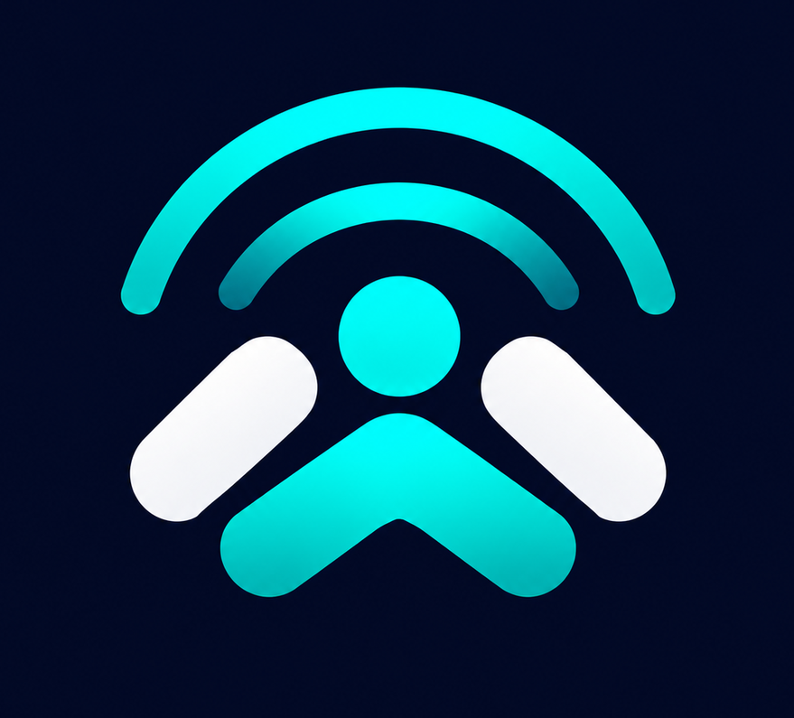
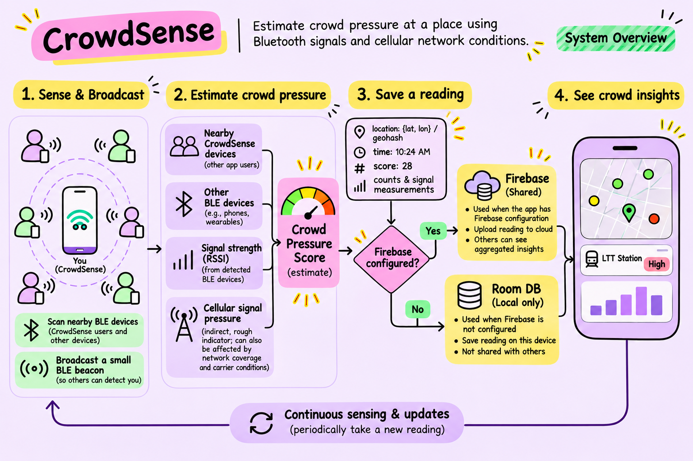
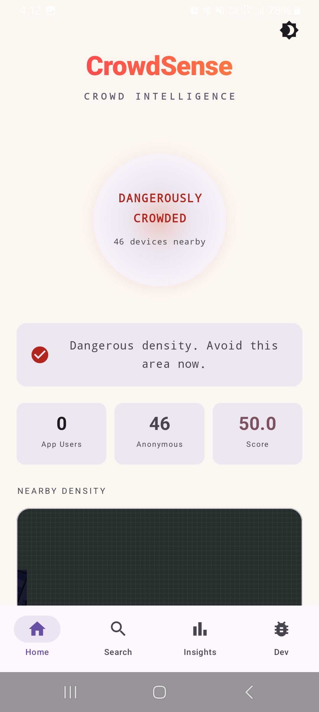
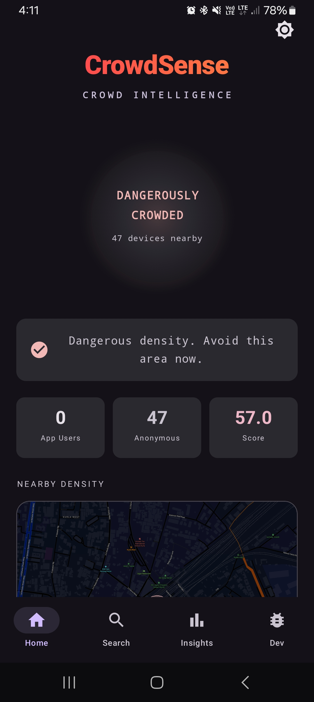
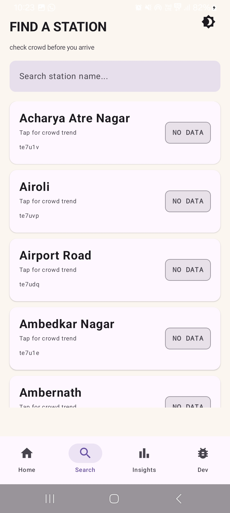
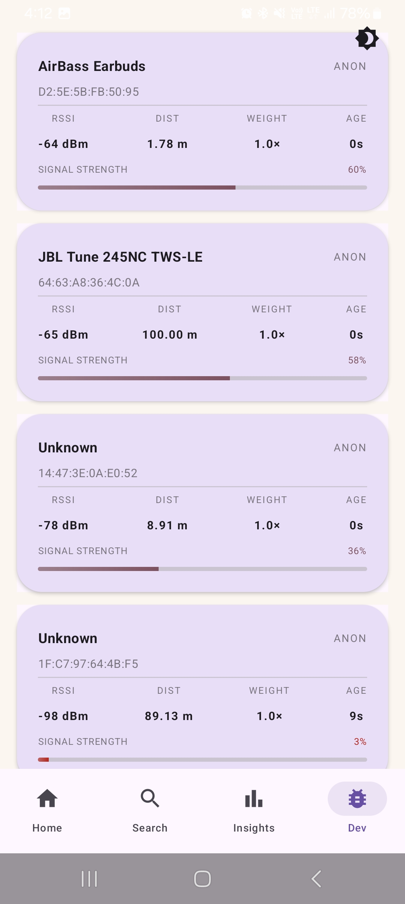
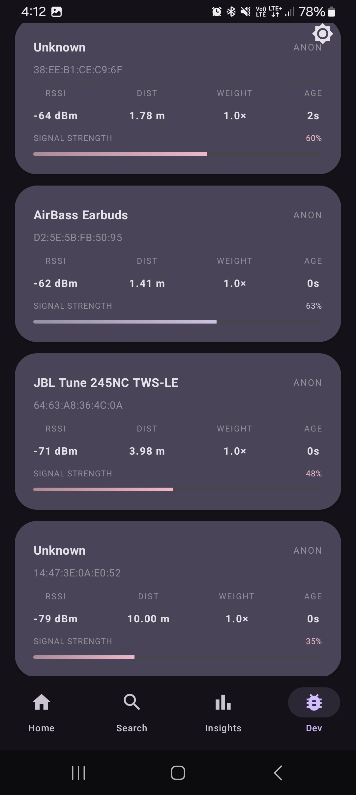
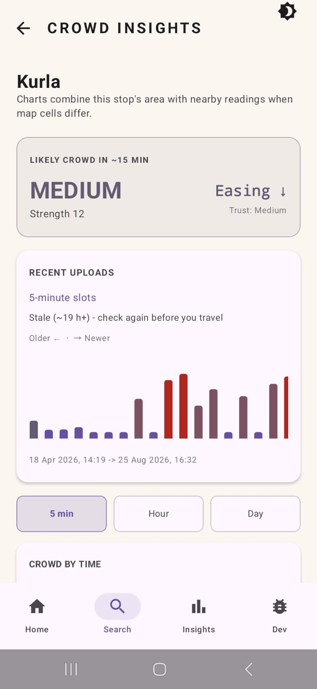

# CrowdSense

<p align="center">
  
</p>

<h3 align="center">Understand how busy a place may be before you go.</h3>

<p align="center">
  CrowdSense is an Android app that estimates crowd pressure from nearby Bluetooth Low Energy (BLE) signals and cellular signal conditions, then presents readings on a map, station search, and time based insights.
</p>

<p align="center">
  <a href="#how-it-works">How it works</a> ·
  <a href="#screenshots">Screenshots</a> ·
  <a href="#getting-started">Getting started</a>
</p>

## Why CrowdSense

CrowdSense explores whether signals already observable by a phone can help people understand how busy nearby places might be. Each participating phone estimates a crowd pressure score locally and saves a reading with its location and time. The app can show readings collected by multiple users when connected to Firebase, or keep readings on the current device using Room for local testing.

A score is an estimate, not an exact count of people. BLE participation, phone hardware, carrier coverage, and other environmental conditions can affect readings.

## How it works



1. **Sense and broadcast:** The phone scans for nearby BLE devices and advertises a small CrowdSense beacon so other participating phones can detect it.
2. **Estimate crowd pressure:** CrowdSense combines nearby detected CrowdSense devices and other BLE devices, signal strength, and a cellular signal pressure estimate. The result is an estimate, not a headcount.
3. **Save a reading:** At intervals, the app records a score with location coordinates/geohash and timestamp. When a location is available, readings are saved about once per minute.
4. **Choose storage automatically:** If Firebase is configured, CrowdSense uses the shared Firebase database. If Firebase is not configured, readings are stored in Room on that device. Configured Firebase does not automatically fall back to Room when the network is unavailable. Firebase map readings older than 10 minutes are omitted.
5. **View insights:** The app presents available readings through the map, station search, and crowd trend charts. Room readings remain on the device that collected them; Firebase readings can be shared across devices.

## Crowd pressure score

The score is calculated on the phone from nearby detected devices and available cellular measurements:

```text
BLE score = (2.5 × CrowdSense app users) + (1.0 × other detected BLE devices)
RSSI multiplier = 1.4 when average RSSI ≥ -60 dBm
                  = 1.2 when average RSSI ≥ -68 dBm
                  = 1.0 otherwise
LTE/5G cellular pressure = clamp(clamp((baseline RSRP - current RSRP) / 5, 0, 5) + RSRQ penalty, 0, 5)
RSRQ penalty = 0 when > -10 dB; 1 when > -15 dB; otherwise 2
Final score = (BLE score × RSSI multiplier) + (2 × cellular pressure)
```

For older cellular technologies, the app uses a simpler signal-strength fallback. If cellular measurements are unavailable, cellular pressure contributes zero.

| Display level | Score |
|---|---:|
| Low | < 8 |
| Medium | 8 to < 20 |
| High | 20 to < 38 |
| Danger | ≥ 38 |

These bands are prototype estimates, not validated crowd counts.
## Screenshots

| Home (light) | Home (dark) | Station search |
|:---:|:---:|:---:|
|  |  |  |

| Developer scan (light) | Developer scan (dark) | Station insights |
|:---:|:---:|:---:|
|  |  |  |
## What you can do

- See crowd pressure estimates on a map.
- Search supported stations and view available crowd readings.
- Explore readings and trends over time.
- Try local mode without configuring Firebase; local readings stay on that device.
- Connect Firebase for shared readings across participating installs.

## Data and privacy

CrowdSense does not collect Bluetooth device names or addresses, and does not collect names or messages. A Firebase reading includes its timestamp, location, score and level, nearby app-user and anonymous-device counts, average BLE RSSI, cellular pressure, and an anonymous Firebase user ID. Local Room records store timestamp, coordinates/geohash, score, and level. Location is needed to associate crowd readings with places.

## Getting started

### Requirements

- Android Studio and the Android SDK required by the project.
- Android 7.0 (API 24) or newer.
- A physical BLE capable Android phone for BLE scanning and advertising. An emulator may not support BLE advertising.
- Location and Bluetooth permissions enabled while using the app.

### Run locally

1. Clone this repository and open it in Android Studio.
2. Let Gradle sync.
3. Run the app on a physical device and grant the requested Bluetooth and location permissions.
4. To use local only mode, run without Firebase configuration. Readings will be saved on that phone.

### Optional: configure Firebase

Firebase is used when the app has a valid Firebase app configuration and database URL. To enable shared data:

1. In Firebase Console, add an Android app with package name `com.crowdsense.app`.
2. Enable Anonymous Authentication and Realtime Database.
3. Download that Android app's `google-services.json` into `app/google-services.json`.
4. Add your database URL to the root `local.properties` file:

   ```properties
   FIREBASE_DB_URL=https://YOUR_PROJECT_ID-default-rtdb.REGION.firebasedatabase.app
   ```

Use database rules appropriate for your deployment. Do not publish credentials or permissive production rules in this repository.

### Optional: configure map tiles

The map uses MapTiler tiles and needs an API key to display the basemap. Add the key to root `local.properties`:

```properties
MAPTILER_API_KEY=your_key_here
```

The key is included in the app build and can be extracted from an APK. Restrict it to the app as supported by MapTiler and set suitable usage limits before distributing a release. Without a key, map tiles may not load.

## Technical overview

- **Android app:** Kotlin, Jetpack Compose, Material 3
- **Sensing:** Android BLE scan and advertise APIs; cellular signal measurements where available
- **Data access:** shared repository used by app screens
- **Shared storage:** Firebase Authentication and Realtime Database
- **Local storage:** Room database on the device, bounded by the app's retention and record limits
- **Map:** osmdroid with MapTiler tiles
- **Location:** Google Play Services Location

## Project layout

```text
app/src/main/java/com/crowdsense/app/
├── bluetooth/       BLE scanning, advertising, and nearby device models
├── localdb/         Room database and local reading store
├── stations/        Station catalog and crowd matching
├── userinterface/   Compose screens
├── navigation/      App navigation
└── util/            Location, signal, and geohash helpers
```

## License

CrowdSense is intended to be released under the **Apache License 2.0**.

## Acknowledgements

CrowdSense uses open source libraries and map data/services. See the project dependencies and in-app map attribution for their respective licenses and attribution requirements.
